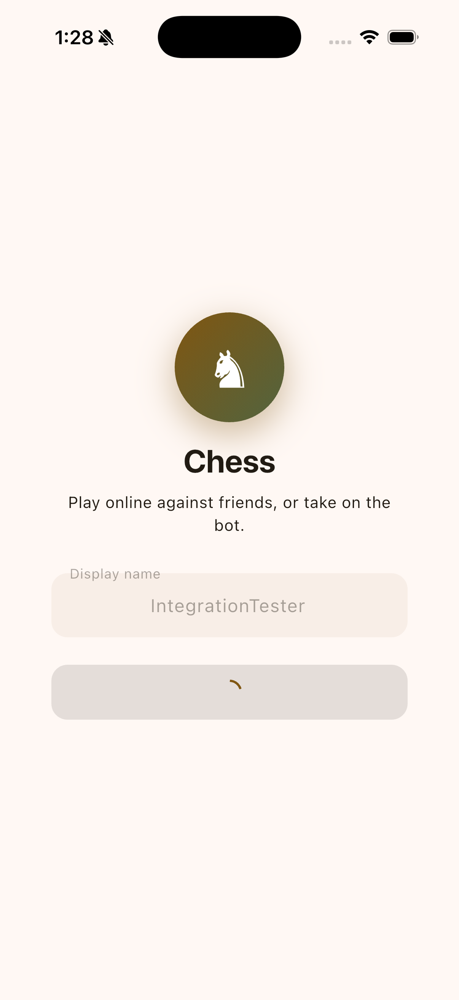
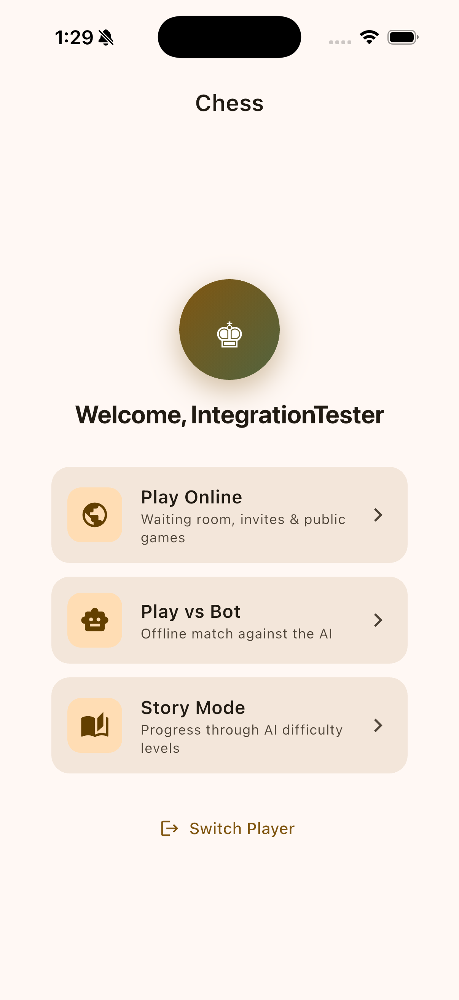
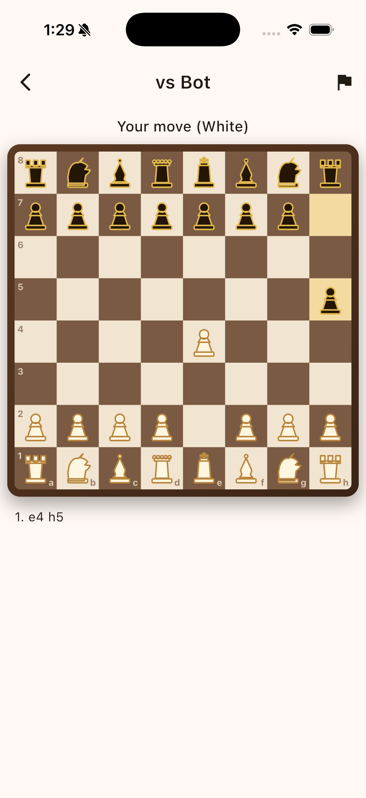
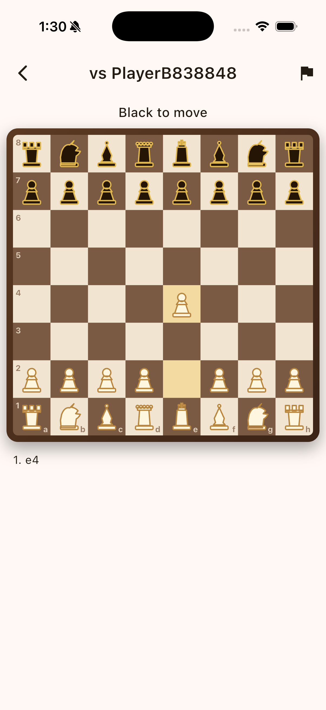

# ♞ Chess

A fullstack, real-time multiplayer chess app — a Flutter mobile client paired
with a Node.js/Socket.IO backend. Players can challenge each other live,
join public games from a waiting room, play an AI opponent offline, or work
through a Story Mode ladder of increasingly difficult bots. All chess rules
(legal moves, check, checkmate, stalemate, draws, castling, en passant,
promotion) are enforced server-side, so the client can never make or accept
an illegal move.

<p align="center">
  
  
  
  
</p>

## Features

**Core**
- Main menu, waiting room, and game board screens
- Server-authoritative move validation — illegal moves are structurally
  impossible from the client, not just discouraged
- White always moves first; turn order strictly enforced
- Real-time multiplayer: public open games (browse and join from the
  waiting room) and private invites by username
- Live board sync — every move is pushed to the opponent the instant it's
  played
- Turn notifications (in-app banner + haptic feedback) when it becomes your
  move
- Game-over messaging sent to both players on checkmate, stalemate, or draw,
  with the reason and winner
- Each game session gets a UUID, generated server-side at creation

**Bonus**
- Restart — reset the board and play again without leaving the game
- AI bot opponent (minimax search + material evaluation) with 3 difficulty
  levels, for offline play or while waiting for a human opponent
- Story Mode — a level ladder against progressively stronger bots, with
  progress persisted on-device

## Screenshots

| Sign in | Main menu | vs. Bot | Live multiplayer |
|---|---|---|---|
|  |  |  |  |

## Tech stack

| | |
|---|---|
| **Client** | Flutter (Dart), `provider` for state management, `socket_io_client` for realtime, `shared_preferences` for on-device persistence |
| **Server** | Node.js, Express, Socket.IO, [`chess.js`](https://github.com/jhlywa/chess.js) for rules enforcement |
| **Storage** | In-memory on the server (no database) — sufficient for the app's scope; see [Limitations](#known-limitations) |

## Architecture

```
┌──────────────────────────┐                                    ┌──────────────────────────┐
│      Flutter client      │          Socket.IO / REST          │     Node.js backend      │
│                          │ <--------------------------------> │                          │
│ - Renders board from     │                                    │ - chess.js: legality,    │
│   server-sent FEN        │                                    │   check/mate/stalemate   │
│ - Sends move attempts    │                                    │ - In-memory game +       │
│ - Never decides          │                                    │   lobby state            │
│   legality itself        │                                    │ - Simple bot (minimax)   │
└──────────────────────────┘                                    └──────────────────────────┘
```

The client is intentionally "dumb" about rules: it asks the server which
moves are legal for a selected square, renders those as highlights, and
sends move attempts for the server to accept or reject. This is the standard
secure pattern for online board games and is what guarantees the "no illegal
moves" requirement rather than just hoping the UI gets it right.

## Project structure

```
chess/
├── lib/                      # Flutter app
│   ├── models/                # Wire-format models (ServerGame, GameResult, ...)
│   ├── providers/              # UserProvider, LobbyProvider, GameProvider
│   ├── screens/                # Username, Main Menu, Waiting Room, Game Board, Story Mode
│   ├── services/               # SocketService, ApiService
│   ├── widgets/                # ChessBoardWidget, ChessPiecePainter, dialogs
│   └── utils/                  # FEN parsing, board helpers
├── integration_test/          # On-device tests driving the real app
├── test/                      # Plain widget tests
├── server/                    # Node.js backend
│   ├── src/
│   │   ├── index.js            # Express + Socket.IO bootstrap
│   │   ├── gameStore.js        # In-memory games/users, UUID generation
│   │   ├── socketHandlers.js   # All Socket.IO event handlers
│   │   ├── chessBot.js         # Minimax bot opponent
│   │   └── routes.js           # REST endpoints
│   └── test/
│       ├── smoke.js            # End-to-end backend test suite
│       └── manual_opponent.js  # Interactive CLI "second player" for manual testing
├── android/, ios/, macos/, windows/, linux/, web/   # Flutter platform targets
└── docs/screenshots/          # Images used in this README
```

## Getting started

### Prerequisites

- [Flutter SDK](https://docs.flutter.dev/get-started/install) (3.x)
- [Node.js](https://nodejs.org/) 18+ and npm
- An iOS Simulator, Android emulator, or physical device

### 1. Start the backend

```bash
cd server
npm install
npm start
```

The server listens on `:3000`.

### 2. Run the app

From the repo root:

```bash
flutter pub get
flutter run
```

By default the app connects to `http://localhost:3000`, which works
out-of-the-box for the iOS Simulator and macOS builds (they share the host's
network). For an Android emulator or a physical device, point it elsewhere:

```bash
# Android emulator (10.0.2.2 maps to the host machine)
flutter run --dart-define=SERVER_URL=http://10.0.2.2:3000

# Physical device on the same network
flutter run --dart-define=SERVER_URL=http://<your-machine-ip>:3000
```

### Troubleshooting: macOS + iCloud Drive

If `~/Documents` is synced by iCloud Drive, iOS/macOS builds can fail with:

```
Failed to codesign ... resource fork, Finder information, or similar detritus not allowed
```

This is iCloud tagging freshly-written build files with extended
attributes that Xcode's codesign step refuses — not a bug in this project.
Fix it once by pointing Flutter's build output outside the synced folder:

```bash
rm -rf build
mkdir -p ~/.flutter-build-cache/chess-build
ln -s ~/.flutter-build-cache/chess-build build
```

## Testing

This project is tested at three levels — unit/API, plain widget, and full
on-device integration (real taps, real network, real second player).

### Backend smoke suite

Boots the real server and drives it with real `socket.io-client`
connections — covering identify/duplicate rejection, lobby state, creating
and joining games, illegal-move rejection (a pawn moving 3 squares, a rook
moving diagonally, castling after the king has moved), turn-order
enforcement, checkmate, stalemate, pawn promotion, en passant, restart,
private invites, and bot play.

```bash
cd server
npm test
```

### Flutter widget test

```bash
flutter test
```

### Integration tests

Each of these launches the actual compiled app on a real device/simulator
against a live backend (`server` must be running first):

| File | What it proves |
|---|---|
| `app_test.dart` | Golden path: sign in → main menu → play vs. bot → make a move |
| `multiplayer_test.dart` | A genuinely independent second socket client joins a game created through the real Waiting Room UI and exchanges live moves with the app |
| `full_game_checkmate_test.dart` | An entire game played via real UI taps ends in checkmate, with the correct winner shown in the game-over dialog |
| `castling_test.dart` | Kingside castling via a single UI tap correctly moves both the king and rook |
| `story_mode_test.dart` | Main menu → Story Mode → a level launches a real bot game |

```bash
flutter test integration_test/<file> -d <deviceId>
```

(`flutter devices` lists available device IDs.)

## API reference

### REST

| Method & path | Description |
|---|---|
| `GET /api/health` | Liveness check |
| `GET /api/games` | List public, open (waiting) games |

### Socket.IO events

**Client → server (request/response, with an ack callback)**

| Event | Payload | Description |
|---|---|---|
| `identify` | `{ username }` | Register a display name for this connection |
| `lobby:enter` / `lobby:leave` | — | Join/leave the lobby broadcast group |
| `game:create` | `{ isPublic?, vsBot?, botDepth?, opponentUsername? }` | Create a game — public, private invite, or vs. bot |
| `game:join` | `{ gameId }` | Join an open public game |
| `game:invite_response` | `{ gameId, accept }` | Accept or decline a private invite |
| `game:legal_moves` | `{ gameId, square }` | Get legal destination squares for a piece |
| `game:move` | `{ gameId, from, to, promotion? }` | Attempt a move |
| `game:restart` | `{ gameId }` | Reset the board; white moves first again |

**Client → server (fire-and-forget)**

| Event | Payload | Description |
|---|---|---|
| `game:resign` | `{ gameId }` | Resign the current game |

**Server → client (pushed)**

| Event | Description |
|---|---|
| `lobby:update` | Online users + open public games changed |
| `game:invite` | You've been invited to a private game |
| `game:state` | Full game state (FEN, turn, status, move history, ...) |
| `game:your_turn` | It's now your move |
| `game:over` | Game ended — `{ reason, winnerColor, winnerUsername }` |
| `game:opponent_disconnected` | Your opponent's connection dropped |

## Known limitations

- Game and user state live in server memory only — restarting the server
  clears all active games. Fine for this app's scope; a persistence layer
  (Redis/Postgres) would be the natural next step for a production
  deployment.
- The bot is a straightforward minimax + material-count evaluator, not a
  tuned chess engine — it's meant to be a reasonable, beatable opponent
  rather than to play at strength.
